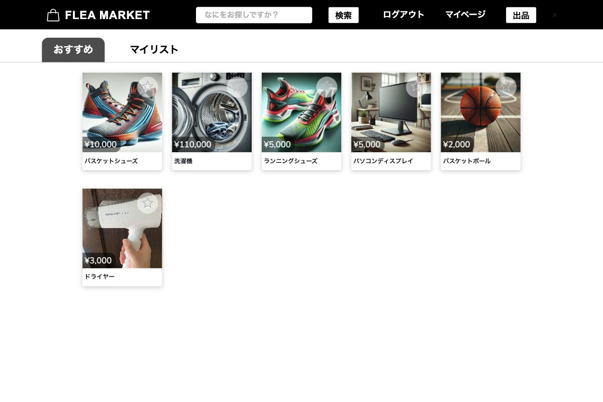
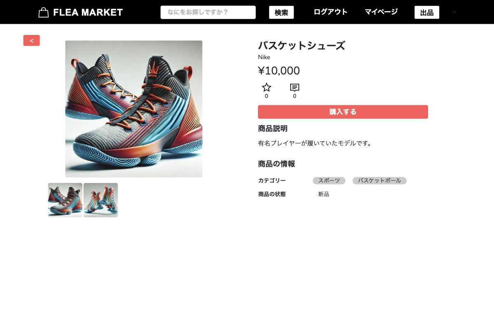
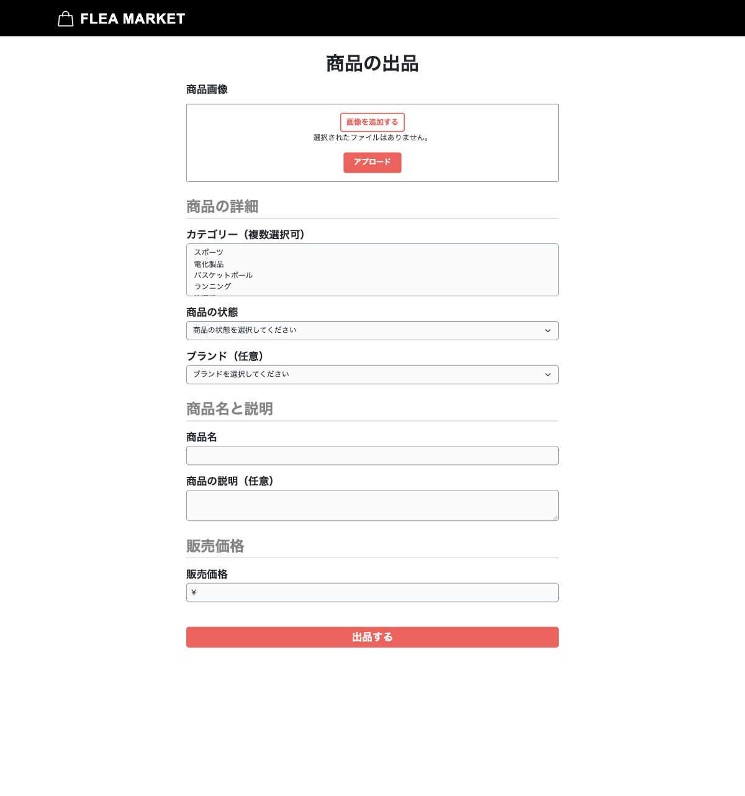
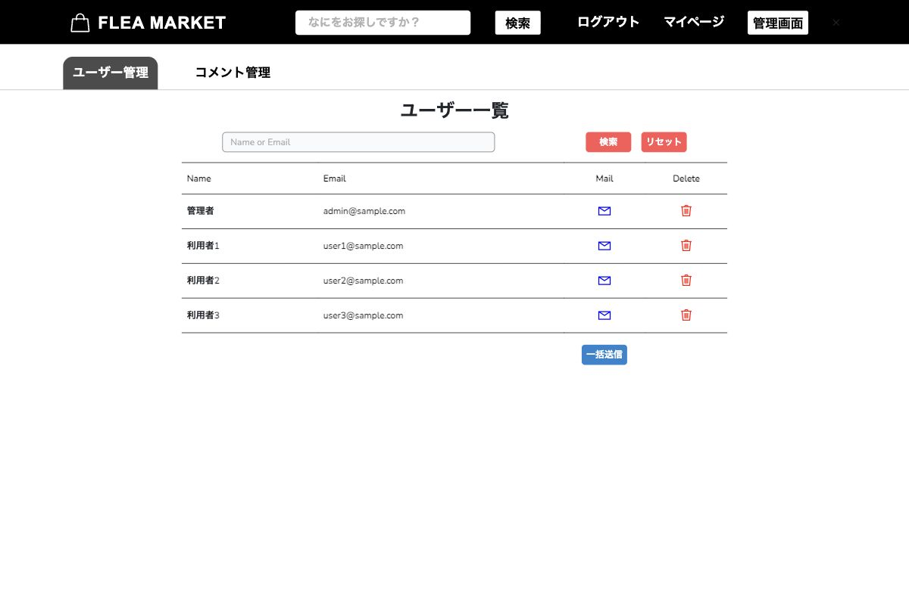
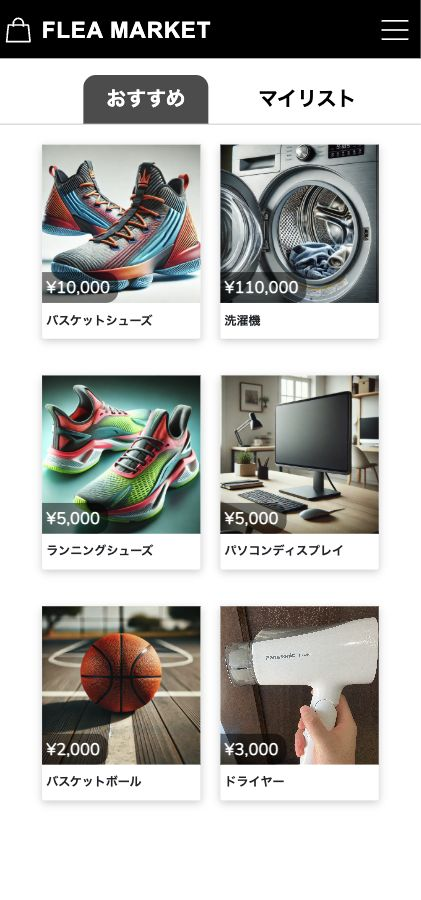
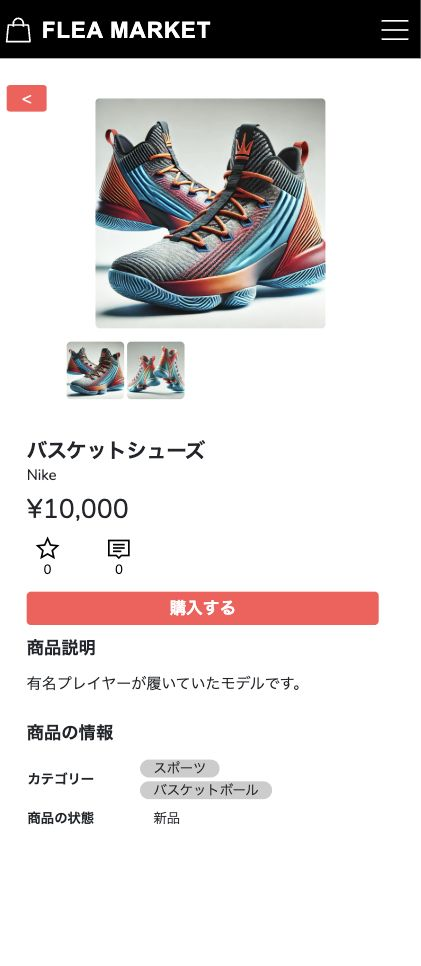
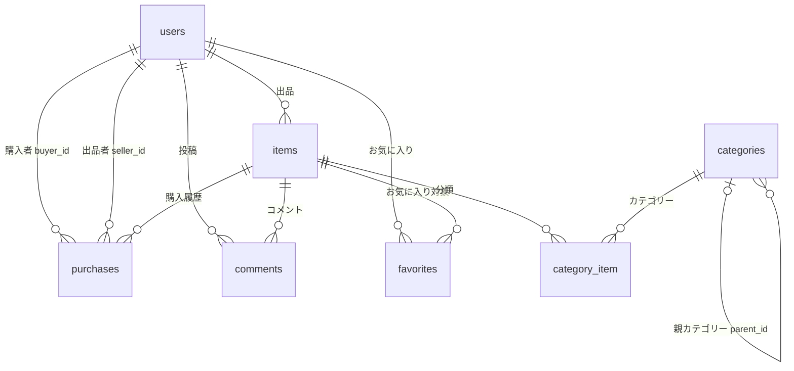

# フリマアプリ（flea-market）

商品の出品・検索・購入と、管理者によるユーザー・コメント管理を実装したフリマアプリです。
スクールの学習課題として制作し、Laravelでの認証、リレーショナルデータベース設計、画像アップロード、Stripeのテスト決済を学びました。



[画面紹介](#画面紹介) · [主な機能](#主な機能) · [実装のポイント](#実装のポイント) · [データベース設計](#データベース設計) · [環境構築](#環境構築)

## 画面紹介

現在のコードと同梱のシードデータを使い、ローカル環境で撮影した画面です。

### 商品詳細

複数の商品画像、価格、ブランド、カテゴリー、商品の状態を表示します。



<details>
<summary>出品フォーム・管理画面・スマートフォン表示を見る</summary>

### 商品の出品

複数画像のアップロード、サムネイルの選択、カテゴリー・状態・ブランド・価格の設定に対応しています。



### 管理者のユーザー一覧

ユーザー検索、削除、個別・一括メール送信の操作をまとめています。
表示しているアカウントはシードデータのデモユーザーです。



### スマートフォン表示

商品一覧と詳細は画面幅に応じてレイアウトが切り替わります。以下はゲスト閲覧時の画面です。




</details>

## 主な機能

| 利用者 | 機能 |
| --- | --- |
| ゲスト | 商品一覧・詳細の閲覧、商品名・ブランド・カテゴリーによる検索 |
| 会員 | 会員登録・ログイン・ログアウト、お気に入り、コメント、商品出品、商品購入 |
| 会員 | 支払方法・配送先の変更、出品・購入履歴の閲覧、プロフィール・アイコンの編集 |
| 管理者 | ユーザー・コメントの検索と削除、コメントの一括削除、個別・一括メール送信 |

支払方法はクレジットカード・コンビニ・銀行振込から選択できます。クレジットカード決済はStripeのテスト環境を使用しています。

## 実装のポイント

- **認証と権限**：Laravel Fortifyで認証を実装し、Spatie Laravel Permissionで管理者・一般ユーザーの権限を管理。管理者用ルートに`role:admin`ミドルウェアを設定しています。([ルート定義](src/routes/web.php))
- **商品検索**：商品名に加え、関連するブランド・カテゴリー・親カテゴリーを検索対象にしています。([Itemモデル](src/app/Models/Item.php))
- **複数画像の管理**：商品・ユーザーの画像を別テーブルで管理し、選択した画像IDをサムネイル・アイコンとして参照。画像のリサイズ処理をサービスにまとめています。([画像サービス](src/app/Services/ImageService.php))
- **購入履歴の保存**：購入者・出品者・支払方法詳細・支払金額を記録し、購入した商品を販売済みに更新します。([購入処理](src/app/Http/Controllers/PurchaseController.php))
- **データの整合性**：カテゴリーと商品の中間テーブル、お気に入りテーブルに複合UNIQUE制約を設定しています。([マイグレーション](src/database/migrations))

## 使用技術

| 区分 | 技術 |
| --- | --- |
| バックエンド | PHP 8.1、Laravel 8.83.27、Laravel Fortify、Spatie Laravel Permission |
| フロントエンド | Blade、HTML / CSS、JavaScript、Bootstrap、Laravel Mix |
| 開発環境 | Docker Compose、MySQL 8.0.35、nginx 1.22.1、MailHog、phpMyAdmin |
| 決済・画像処理 | Stripe（テスト環境）、Intervention Image |
| テスト | PHPUnit（Featureテスト） |
| AWSでの構築に使用 | EC2、RDS、S3 |

バージョン・依存関係は[composer.lock](src/composer.lock)、[package-lock.json](src/package-lock.json)、[Docker構成](docker-compose.yml)を参照してください。

## データベース設計

マイグレーションの定義から作成した、主要テーブルの関係です。画像・ブランド・状態・住所・支払方法・権限管理を含む詳細は[ER図とテーブル定義](docs/database.md)にまとめています。



## 環境構築

Docker DesktopとGitを使用します。以下は初回の開発環境構築手順です。

### 1. リポジトリの取得と設定

```bash
git clone https://github.com/kazuhitotakao/flea-market.git
cd flea-market
cp src/.env.example src/.env
```

`src/.env`の以下の項目を設定します。DBの値は`docker-compose.yml`の開発用設定に対応しています。

```dotenv
APP_NAME=flea-market
APP_ENV=local
APP_URL=http://localhost

DB_CONNECTION=mysql
DB_HOST=mysql
DB_PORT=3306
DB_DATABASE=laravel_db
DB_USERNAME=laravel_user
DB_PASSWORD=laravel_pass

MAIL_MAILER=smtp
MAIL_HOST=mailhog
MAIL_PORT=1025
MAIL_USERNAME=null
MAIL_PASSWORD=null
MAIL_ENCRYPTION=null
MAIL_FROM_ADDRESS=info@example.com
MAIL_FROM_NAME="${APP_NAME}"
```

### 2. コンテナの起動と初期データの作成

```bash
docker compose up -d --build
docker compose exec php composer install
docker compose exec php php artisan key:generate
docker compose exec php php artisan migrate --seed
docker compose exec php php artisan storage:link
```

MySQLの起動直後に接続エラーが出た場合は、起動完了後にマイグレーションを再実行してください。
`storage`と`bootstrap/cache`はPHPの実行ユーザーが書き込める権限にします。
表示用のCSS・JavaScriptは`src/public`に含まれています。

### 3. アプリを開く

| サービス | URL |
| --- | --- |
| アプリ（ログイン） | http://localhost/login |
| ゲストの商品一覧 | http://localhost/guest |
| phpMyAdmin | http://localhost:8080 |
| MailHog（開発用メール確認） | http://localhost:8025 |

### デモアカウント

初回のシーディングで以下のアカウントを作成します。パスワードはすべて`password`です。

| 権限 | メールアドレス |
| --- | --- |
| 管理者 | admin@sample.com |
| 一般ユーザー | user1@sample.com |
| 一般ユーザー | user2@sample.com |
| 一般ユーザー | user3@sample.com |

商品・カテゴリー・ブランド・商品画像もシードデータに含まれているため、出品前でも一覧と詳細を確認できます。

### Stripeのテスト決済

クレジットカード決済を試す場合は、`src/.env`に自分のStripeテスト用キーを追加します。

```dotenv
STRIPE_PUBLIC_KEY=
STRIPE_SECRET_KEY=
```

テスト用カードは[Stripe公式ドキュメント](https://docs.stripe.com/testing?locale=ja-JP)を参照してください。決済キーの設定は、商品閲覧やログインの確認には不要です。

## テスト

認証が必要な各画面や、検索・出品・購入・管理機能のFeatureテストを[src/tests/Feature](src/tests/Feature)に置いています。
既存のテスト設定はMySQLの`demo_test`データベースを使用します。

```bash
docker compose exec mysql mysql -uroot -proot -e 'CREATE DATABASE IF NOT EXISTS demo_test;'
docker compose exec php php artisan test tests/Feature
```

## ディレクトリ構成

```text
docker/                     nginx・PHP・MySQLの開発用設定
docs/                       ER図・テーブル定義・画面画像
src/app/Http/Controllers/    各画面・操作の処理
src/app/Http/Requests/       入力値の検証
src/app/Models/             データ取得・保存とリレーション
src/app/Services/           共通の画像処理
src/database/               マイグレーション・シーダー・ファクトリー
src/resources/views/        Bladeテンプレート
src/routes/                 ルート定義
src/tests/Feature/          機能テスト
```
