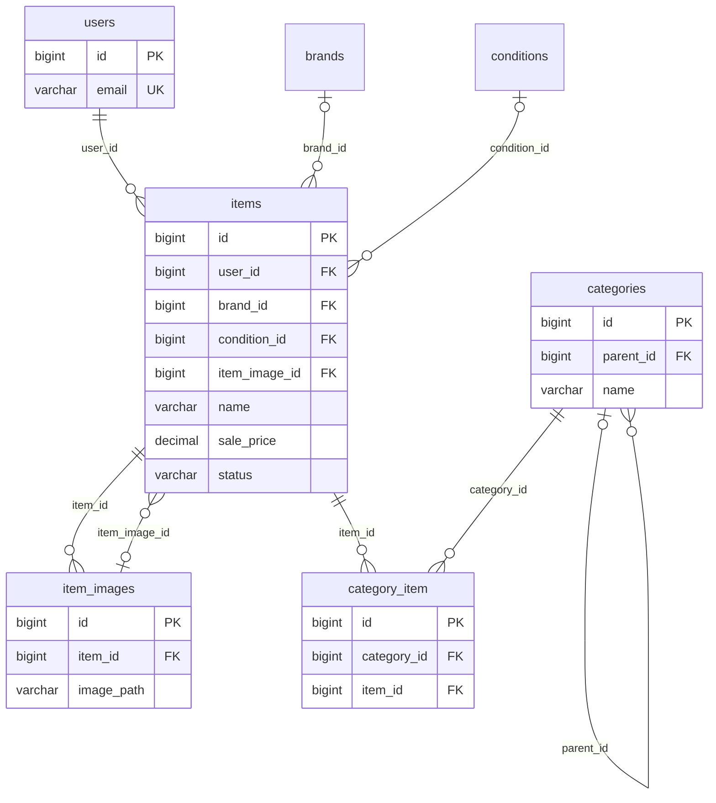
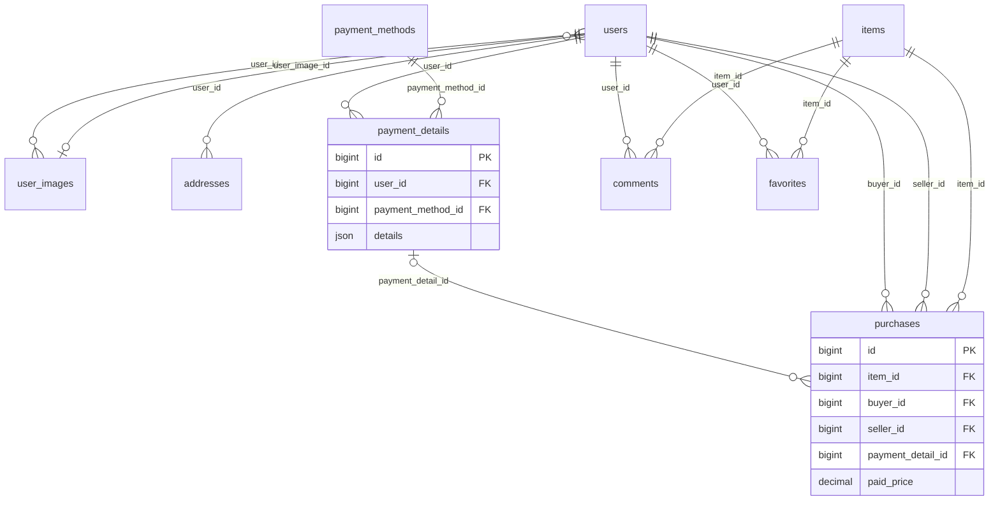
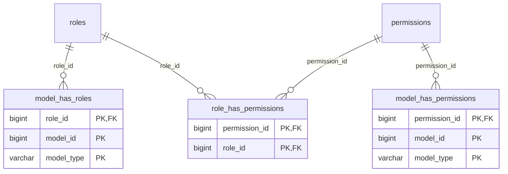

# データベース設計

定義の根拠は[src/database/migrations](../src/database/migrations)です。PHP 8.1・MySQL 8.0.35で全マイグレーションを実行し、作成されたカラム・インデックス・外部キーと照合しています。
業務用14テーブル、権限管理5テーブル、Laravel関連3テーブルを掲載します。Laravelのマイグレーション履歴テーブルは省略しています。

## ER図

図の線はDBの外部キー制約を表します。NULLを許容する外部キーは参照先が任意であることを示しています。

### 商品・カテゴリー・画像

`items.item_image_id`は選択中のサムネイル、`item_images.item_id`は各画像の所属商品を表します。

### ユーザー・購入・コメント・お気に入り

`users.user_image_id`は選択中のアイコン画像を表します。`payment_details.details`はNULLを許容するJSONカラムで、カード番号を保存するためのカラムではありません。
`addresses.user_id`と`purchases.item_id`にはUNIQUE制約がないため、図ではDBの定義に合わせて1対多で表しています。

### 権限管理

`model_id`と`model_type`はSpatie Laravel Permissionのポリモーフィック参照です。シーダーではUserモデルにロールを付与していますが、`users`へのDB外部キー制約はありません。

## テーブル一覧

| テーブル | 用途 |
| --- | --- |
| [users](#users) | ユーザー・選択中のアイコン画像 |
| [user_images](#user_images) | ユーザーがアップロードした画像 |
| [addresses](#addresses) | ユーザーの住所 |
| [items](#items) | 商品・出品者・選択中のサムネイル |
| [item_images](#item_images) | 商品の複数画像 |
| [brands](#brands) | ブランド |
| [conditions](#conditions) | 商品の状態 |
| [categories](#categories) | 親子階層を持つカテゴリー |
| [category_item](#category_item) | 商品とカテゴリーの中間テーブル |
| [favorites](#favorites) | お気に入り |
| [comments](#comments) | 商品へのコメント |
| [payment_methods](#payment_methods) | 支払方法 |
| [payment_details](#payment_details) | ユーザーの支払方法詳細 |
| [purchases](#purchases) | 購入履歴・購入者・出品者・支払金額 |
| [roles](#roles) | ロール |
| [permissions](#permissions) | 権限 |
| [model_has_roles](#model_has_roles) | モデルとロールの割り当て |
| [model_has_permissions](#model_has_permissions) | モデルへの直接の権限付与 |
| [role_has_permissions](#role_has_permissions) | ロールと権限の中間テーブル |
| [password_resets](#password_resets) | パスワード再設定トークン |
| [personal_access_tokens](#personal_access_tokens) | APIトークン |
| [failed_jobs](#failed_jobs) | 失敗したジョブ |

## カラム・制約

PKは主キー、UKは単一カラムのUNIQUE、INDEXはインデックス、FKは外部キーです。複合主キー・複合UNIQUEは各テーブルの下に記載します。型はMySQLへの適用結果です。

### users

ユーザー・選択中のアイコン画像。

| カラム | 型 | NULL許容 | キー | 既定値 |
| --- | --- | --- | --- | --- |
| `id` | `bigint unsigned` | 不可 | PK | AUTO_INCREMENT |
| `name` | `varchar(255)` | 可 | — | NULL |
| `email` | `varchar(255)` | 不可 | UK | — |
| `email_verified_at` | `timestamp` | 可 | — | NULL |
| `password` | `varchar(255)` | 不可 | — | — |
| `two_factor_secret` | `text` | 可 | — | NULL |
| `two_factor_recovery_codes` | `text` | 可 | — | NULL |
| `two_factor_confirmed_at` | `timestamp` | 可 | — | NULL |
| `user_image_id` | `bigint unsigned` | 可 | INDEX, FK | NULL |
| `remember_token` | `varchar(100)` | 可 | — | NULL |
| `created_at` | `timestamp` | 可 | — | NULL |
| `updated_at` | `timestamp` | 可 | — | NULL |

- PRIMARY KEY：`id`
- UNIQUE：`email`
- FK：`user_image_id` → `user_images.id`（削除時：SET NULL）

### user_images

ユーザーがアップロードした画像。

| カラム | 型 | NULL許容 | キー | 既定値 |
| --- | --- | --- | --- | --- |
| `id` | `bigint unsigned` | 不可 | PK | AUTO_INCREMENT |
| `user_id` | `bigint unsigned` | 不可 | INDEX, FK | — |
| `image_path` | `varchar(255)` | 不可 | — | — |
| `created_at` | `timestamp` | 可 | — | NULL |
| `updated_at` | `timestamp` | 可 | — | NULL |

- PRIMARY KEY：`id`
- FK：`user_id` → `users.id`（削除時：CASCADE）

### addresses

ユーザーの住所。

| カラム | 型 | NULL許容 | キー | 既定値 |
| --- | --- | --- | --- | --- |
| `id` | `bigint unsigned` | 不可 | PK | AUTO_INCREMENT |
| `user_id` | `bigint unsigned` | 不可 | INDEX, FK | — |
| `postcode` | `varchar(7)` | 可 | — | NULL |
| `address` | `varchar(255)` | 可 | — | NULL |
| `building` | `varchar(255)` | 可 | — | NULL |
| `created_at` | `timestamp` | 可 | — | NULL |
| `updated_at` | `timestamp` | 可 | — | NULL |

- PRIMARY KEY：`id`
- FK：`user_id` → `users.id`（削除時：CASCADE）

### items

商品・出品者・選択中のサムネイル。

| カラム | 型 | NULL許容 | キー | 既定値 |
| --- | --- | --- | --- | --- |
| `id` | `bigint unsigned` | 不可 | PK | AUTO_INCREMENT |
| `name` | `varchar(255)` | 不可 | — | — |
| `item_image_id` | `bigint unsigned` | 可 | INDEX, FK | NULL |
| `condition_id` | `bigint unsigned` | 可 | INDEX, FK | NULL |
| `brand_id` | `bigint unsigned` | 可 | INDEX, FK | NULL |
| `description` | `text` | 可 | — | NULL |
| `sale_price` | `decimal(9,2)` | 可 | — | NULL |
| `user_id` | `bigint unsigned` | 不可 | INDEX, FK | — |
| `status` | `varchar(255)` | 不可 | — | available |
| `created_at` | `timestamp` | 可 | — | NULL |
| `updated_at` | `timestamp` | 可 | — | NULL |

- PRIMARY KEY：`id`
- FK：`brand_id` → `brands.id`（削除時：SET NULL）
- FK：`condition_id` → `conditions.id`（削除時：SET NULL）
- FK：`item_image_id` → `item_images.id`（削除時：SET NULL）
- FK：`user_id` → `users.id`（削除時：CASCADE）

### item_images

商品の複数画像。

| カラム | 型 | NULL許容 | キー | 既定値 |
| --- | --- | --- | --- | --- |
| `id` | `bigint unsigned` | 不可 | PK | AUTO_INCREMENT |
| `item_id` | `bigint unsigned` | 不可 | INDEX, FK | — |
| `image_path` | `varchar(255)` | 不可 | — | — |
| `created_at` | `timestamp` | 可 | — | NULL |
| `updated_at` | `timestamp` | 可 | — | NULL |

- PRIMARY KEY：`id`
- FK：`item_id` → `items.id`（削除時：CASCADE）

### brands

ブランド。

| カラム | 型 | NULL許容 | キー | 既定値 |
| --- | --- | --- | --- | --- |
| `id` | `bigint unsigned` | 不可 | PK | AUTO_INCREMENT |
| `name` | `varchar(255)` | 不可 | — | — |
| `description` | `varchar(255)` | 可 | — | NULL |
| `created_at` | `timestamp` | 可 | — | NULL |
| `updated_at` | `timestamp` | 可 | — | NULL |

- PRIMARY KEY：`id`

### conditions

商品の状態。

| カラム | 型 | NULL許容 | キー | 既定値 |
| --- | --- | --- | --- | --- |
| `id` | `bigint unsigned` | 不可 | PK | AUTO_INCREMENT |
| `name` | `varchar(255)` | 不可 | — | — |
| `created_at` | `timestamp` | 可 | — | NULL |
| `updated_at` | `timestamp` | 可 | — | NULL |

- PRIMARY KEY：`id`

### categories

親子階層を持つカテゴリー。

| カラム | 型 | NULL許容 | キー | 既定値 |
| --- | --- | --- | --- | --- |
| `id` | `bigint unsigned` | 不可 | PK | AUTO_INCREMENT |
| `name` | `varchar(255)` | 不可 | — | — |
| `parent_id` | `bigint unsigned` | 可 | INDEX, FK | NULL |
| `created_at` | `timestamp` | 可 | — | NULL |
| `updated_at` | `timestamp` | 可 | — | NULL |

- PRIMARY KEY：`id`
- FK：`parent_id` → `categories.id`（削除時：SET NULL）

### category_item

商品とカテゴリーの中間テーブル。

| カラム | 型 | NULL許容 | キー | 既定値 |
| --- | --- | --- | --- | --- |
| `id` | `bigint unsigned` | 不可 | PK | AUTO_INCREMENT |
| `category_id` | `bigint unsigned` | 不可 | INDEX, FK | — |
| `item_id` | `bigint unsigned` | 不可 | INDEX, FK | — |
| `created_at` | `timestamp` | 可 | — | NULL |
| `updated_at` | `timestamp` | 可 | — | NULL |

- UNIQUE：`category_id`, `item_id`
- PRIMARY KEY：`id`
- FK：`category_id` → `categories.id`（削除時：CASCADE）
- FK：`item_id` → `items.id`（削除時：CASCADE）

### favorites

お気に入り。

| カラム | 型 | NULL許容 | キー | 既定値 |
| --- | --- | --- | --- | --- |
| `id` | `bigint unsigned` | 不可 | PK | AUTO_INCREMENT |
| `item_id` | `bigint unsigned` | 不可 | INDEX, FK | — |
| `user_id` | `bigint unsigned` | 不可 | INDEX, FK | — |
| `created_at` | `timestamp` | 可 | — | NULL |
| `updated_at` | `timestamp` | 可 | — | NULL |

- UNIQUE：`user_id`, `item_id`
- PRIMARY KEY：`id`
- FK：`item_id` → `items.id`（削除時：CASCADE）
- FK：`user_id` → `users.id`（削除時：CASCADE）

### comments

商品へのコメント。

| カラム | 型 | NULL許容 | キー | 既定値 |
| --- | --- | --- | --- | --- |
| `id` | `bigint unsigned` | 不可 | PK | AUTO_INCREMENT |
| `item_id` | `bigint unsigned` | 不可 | INDEX, FK | — |
| `user_id` | `bigint unsigned` | 不可 | INDEX, FK | — |
| `comment` | `varchar(255)` | 不可 | — | — |
| `created_at` | `timestamp` | 可 | — | NULL |
| `updated_at` | `timestamp` | 可 | — | NULL |

- PRIMARY KEY：`id`
- FK：`item_id` → `items.id`（削除時：CASCADE）
- FK：`user_id` → `users.id`（削除時：CASCADE）

### payment_methods

支払方法。

| カラム | 型 | NULL許容 | キー | 既定値 |
| --- | --- | --- | --- | --- |
| `id` | `bigint unsigned` | 不可 | PK | AUTO_INCREMENT |
| `name` | `varchar(255)` | 不可 | — | — |
| `description` | `varchar(255)` | 可 | — | NULL |
| `created_at` | `timestamp` | 可 | — | NULL |
| `updated_at` | `timestamp` | 可 | — | NULL |

- PRIMARY KEY：`id`

### payment_details

ユーザーの支払方法詳細。

| カラム | 型 | NULL許容 | キー | 既定値 |
| --- | --- | --- | --- | --- |
| `id` | `bigint unsigned` | 不可 | PK | AUTO_INCREMENT |
| `payment_method_id` | `bigint unsigned` | 不可 | INDEX, FK | — |
| `user_id` | `bigint unsigned` | 不可 | INDEX, FK | — |
| `details` | `json` | 可 | — | NULL |
| `created_at` | `timestamp` | 可 | — | NULL |
| `updated_at` | `timestamp` | 可 | — | NULL |

- PRIMARY KEY：`id`
- FK：`payment_method_id` → `payment_methods.id`（削除時：CASCADE）
- FK：`user_id` → `users.id`（削除時：CASCADE）

### purchases

購入履歴・購入者・出品者・支払金額。

| カラム | 型 | NULL許容 | キー | 既定値 |
| --- | --- | --- | --- | --- |
| `id` | `bigint unsigned` | 不可 | PK | AUTO_INCREMENT |
| `item_id` | `bigint unsigned` | 不可 | INDEX, FK | — |
| `buyer_id` | `bigint unsigned` | 不可 | INDEX, FK | — |
| `seller_id` | `bigint unsigned` | 不可 | INDEX, FK | — |
| `payment_detail_id` | `bigint unsigned` | 可 | INDEX, FK | NULL |
| `paid_price` | `decimal(9,2)` | 不可 | — | — |
| `created_at` | `timestamp` | 可 | — | NULL |
| `updated_at` | `timestamp` | 可 | — | NULL |

- PRIMARY KEY：`id`
- FK：`buyer_id` → `users.id`（削除時：CASCADE）
- FK：`item_id` → `items.id`（削除時：CASCADE）
- FK：`payment_detail_id` → `payment_details.id`（削除時：SET NULL）
- FK：`seller_id` → `users.id`（削除時：CASCADE）

### roles

ロール。

| カラム | 型 | NULL許容 | キー | 既定値 |
| --- | --- | --- | --- | --- |
| `id` | `bigint unsigned` | 不可 | PK | AUTO_INCREMENT |
| `name` | `varchar(255)` | 不可 | INDEX | — |
| `guard_name` | `varchar(255)` | 不可 | — | — |
| `created_at` | `timestamp` | 可 | — | NULL |
| `updated_at` | `timestamp` | 可 | — | NULL |

- PRIMARY KEY：`id`
- UNIQUE：`name`, `guard_name`

### permissions

権限。

| カラム | 型 | NULL許容 | キー | 既定値 |
| --- | --- | --- | --- | --- |
| `id` | `bigint unsigned` | 不可 | PK | AUTO_INCREMENT |
| `name` | `varchar(255)` | 不可 | INDEX | — |
| `guard_name` | `varchar(255)` | 不可 | — | — |
| `created_at` | `timestamp` | 可 | — | NULL |
| `updated_at` | `timestamp` | 可 | — | NULL |

- UNIQUE：`name`, `guard_name`
- PRIMARY KEY：`id`

### model_has_roles

モデルとロールの割り当て。

| カラム | 型 | NULL許容 | キー | 既定値 |
| --- | --- | --- | --- | --- |
| `role_id` | `bigint unsigned` | 不可 | PK, FK | — |
| `model_type` | `varchar(255)` | 不可 | PK | — |
| `model_id` | `bigint unsigned` | 不可 | PK | — |

- PRIMARY KEY：`role_id`, `model_id`, `model_type`
- FK：`role_id` → `roles.id`（削除時：CASCADE）

### model_has_permissions

モデルへの直接の権限付与。

| カラム | 型 | NULL許容 | キー | 既定値 |
| --- | --- | --- | --- | --- |
| `permission_id` | `bigint unsigned` | 不可 | PK, FK | — |
| `model_type` | `varchar(255)` | 不可 | PK | — |
| `model_id` | `bigint unsigned` | 不可 | PK | — |

- PRIMARY KEY：`permission_id`, `model_id`, `model_type`
- FK：`permission_id` → `permissions.id`（削除時：CASCADE）

### role_has_permissions

ロールと権限の中間テーブル。

| カラム | 型 | NULL許容 | キー | 既定値 |
| --- | --- | --- | --- | --- |
| `permission_id` | `bigint unsigned` | 不可 | PK, FK | — |
| `role_id` | `bigint unsigned` | 不可 | PK, FK | — |

- PRIMARY KEY：`permission_id`, `role_id`
- FK：`permission_id` → `permissions.id`（削除時：CASCADE）
- FK：`role_id` → `roles.id`（削除時：CASCADE）

### password_resets

パスワード再設定トークン。

| カラム | 型 | NULL許容 | キー | 既定値 |
| --- | --- | --- | --- | --- |
| `email` | `varchar(255)` | 不可 | INDEX | — |
| `token` | `varchar(255)` | 不可 | — | — |
| `created_at` | `timestamp` | 可 | — | NULL |

### personal_access_tokens

APIトークン。

| カラム | 型 | NULL許容 | キー | 既定値 |
| --- | --- | --- | --- | --- |
| `id` | `bigint unsigned` | 不可 | PK | AUTO_INCREMENT |
| `tokenable_type` | `varchar(255)` | 不可 | INDEX | — |
| `tokenable_id` | `bigint unsigned` | 不可 | — | — |
| `name` | `varchar(255)` | 不可 | — | — |
| `token` | `varchar(64)` | 不可 | UK | — |
| `abilities` | `text` | 可 | — | NULL |
| `last_used_at` | `timestamp` | 可 | — | NULL |
| `created_at` | `timestamp` | 可 | — | NULL |
| `updated_at` | `timestamp` | 可 | — | NULL |

- UNIQUE：`token`
- PRIMARY KEY：`id`

### failed_jobs

失敗したジョブ。

| カラム | 型 | NULL許容 | キー | 既定値 |
| --- | --- | --- | --- | --- |
| `id` | `bigint unsigned` | 不可 | PK | AUTO_INCREMENT |
| `uuid` | `varchar(255)` | 不可 | UK | — |
| `connection` | `text` | 不可 | — | — |
| `queue` | `text` | 不可 | — | — |
| `payload` | `longtext` | 不可 | — | — |
| `exception` | `longtext` | 不可 | — | — |
| `failed_at` | `timestamp` | 不可 | — | CURRENT_TIMESTAMP |

- UNIQUE：`uuid`
- PRIMARY KEY：`id`
